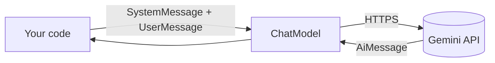
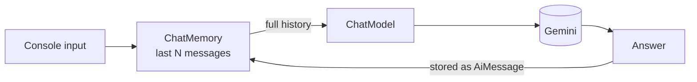
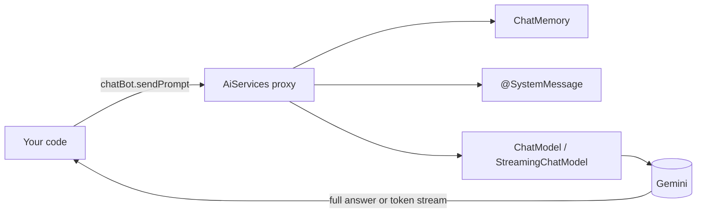
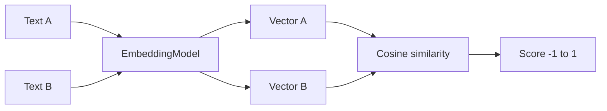
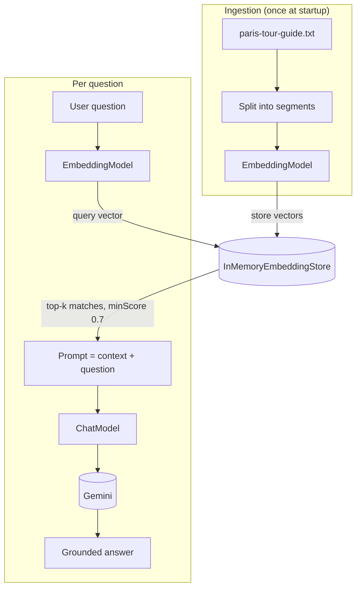
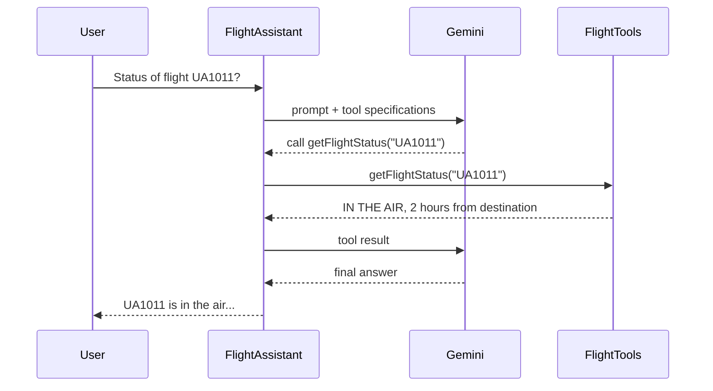

# GenAI With Java

Hands-on examples for building Generative AI features in plain Java with [LangChain4j](https://docs.langchain4j.dev/) and Google Gemini.

No Spring, no framework magic. Every example is a single runnable class with a `main` method, so you can read it top to bottom and see exactly what goes to the model and what comes back. The examples build on each other, starting from a one-line chat call and ending with a RAG assistant and an agent that calls Java methods as tools.

## What you'll learn

| Module | Package | Concepts |
|---|---|---|
| 1. Chat basics | `basics` | `ChatModel`, single prompts, system vs user messages, prompt templates |
| 2. Conversation memory | `basics` | Why LLMs are stateless, `MessageWindowChatMemory` |
| 3. Context stuffing | `basics` | Putting a whole document in the prompt and its limits |
| 4. AI Services | `chatservices` | Declarative interfaces with `AiServices`, `@SystemMessage`, token streaming |
| 5. Embeddings | `embedding` | Turning text into vectors, cosine similarity from scratch |
| 6. RAG | `rag` | Ingestion, in-memory vector store, retrieval, manual RAG vs `ContentRetriever` |
| 7. Tools / function calling | `tools` | `@Tool` methods the model can decide to invoke |

## Tech stack

- Java 25
- LangChain4j 1.22.0 (`langchain4j`, `langchain4j-google-ai-gemini`)
- Google Gemini for chat and embeddings
- Maven, Lombok, SLF4J

## Getting started

### Prerequisites

- JDK 25
- Maven 3.9+
- A Gemini API key from [Google AI Studio](https://aistudio.google.com/app/apikey)

### Configure

Edit `src/main/resources/application.properties`:

```properties
# Leave empty to read from the API_KEY environment variable instead
api.key=

# Chat model (must support generateContent)
model.name=gemini-2.5-flash

# Embedding model (must support embedContent), used by the embedding and rag packages
embedding-model=gemini-embedding-001

log.requests.responses=true
```

The safer option is to keep `api.key` empty and export the key, so it never lands in Git:

```bash
export API_KEY=your-gemini-api-key        # macOS / Linux
setx API_KEY "your-gemini-api-key"        # Windows
```

`AppConfig` checks the properties file first and falls back to the `API_KEY` environment variable.

> **Chat and embedding models are not interchangeable.** If you point `embedding-model` at a chat model such as a `gemini-*-flash`, the API returns
> `... is not supported for embedContent`. You can list the models available to your key, along with their supported methods, at
> `https://generativelanguage.googleapis.com/v1beta/models?key=YOUR_KEY`.

### Run an example

From your IDE, open any class below and run its `main` method. From the terminal:

```bash
mvn compile exec:java -Dexec.mainClass=com.learning.basics.BasicChatModel
```

Interactive examples read prompts from the console. Press Enter on an empty line to skip; `ChatStreamingService` exits on `exit`, `quit` or `bye`.

## Examples

### 1. Chat basics (`com.learning.basics`)

| Class | What it shows |
|---|---|
| `BasicChatModel` | The smallest possible call: build a `ChatModel`, send one string, print the answer. |
| `DIfferentChatMessages` | Combining a `SystemMessage` (persona and rules) with a `UserMessage` (the question). |
| `Templates` | `PromptTemplate` with `{{placeholders}}` filled from a `Map` for reusable prompts. |



### 2. Conversation memory (`com.learning.basics`)

| Class | What it shows |
|---|---|
| `ChatWithoutMemory` | A REPL where every prompt is independent. Ask "what did I just say?" and the model has no idea. |
| `ChatWithMemory` | The same REPL, but each turn is stored in `MessageWindowChatMemory` and the whole window is sent every time. |



The key takeaway: the model itself remembers nothing. "Memory" is just your application resending the conversation.

### 3. Context stuffing (`com.learning.basics`)

| Class | What it shows |
|---|---|
| `ChatWithFileInContext` | Loads `the-midnight-heap.txt` (a short story about a Java memory leak) and sends the entire text with every question. |

This works for small documents and is the simplest way to ground answers, but cost and latency grow with document size and you eventually hit the context window. That limitation is the motivation for RAG.

### 4. AI Services (`com.learning.chatservices`)

| Class | What it shows |
|---|---|
| `ChatWithAiService` | Define a plain Java interface; `AiServices` generates the implementation and wires in memory. |
| `ChatStreamingService` | Returns a `TokenStream` so text prints token by token, with a `@SystemMessage` persona. |



### 5. Embeddings (`com.learning.embedding`)

| Class | What it shows |
|---|---|
| `EmbeddingBasics` | Embeds one sentence and prints the vector and its dimension. |
| `EmbeddingsComparision` | Embeds two unrelated sentences and computes cosine similarity by hand (dot product and magnitudes). |



### 6. Retrieval-Augmented Generation (`com.learning.rag`)

Both examples answer questions about a Paris tour guide document (`src/main/resources/paris-tour-guide.txt`).

| Class | What it shows |
|---|---|
| `BasicRAG` | RAG by hand: embed each line, store in `InMemoryEmbeddingStore`, search with `EmbeddingSearchRequest`, then add the matches to the prompt yourself. |
| `RAGUsingAiService` | The same idea the LangChain4j way: `EmbeddingStoreIngestor` with a sentence splitter, `EmbeddingStoreContentRetriever`, plugged into an `AiServices` assistant. |



Doing it manually first makes it obvious what `ContentRetriever` is automating.

### 7. Tools / function calling (`com.learning.tools`)

| Class | What it shows |
|---|---|
| `FlightTools` | Three `@Tool` methods (flight status, aircraft type, cost) returning mock data. The tool descriptions are what the model reads to pick a method. |
| `FlightInfo` | A `FlightAssistant` built with `AiServices` that answers multi-turn flight questions, using memory so "it" refers to the flight from the previous turn. |



## Project structure

```
src/main/java/com/learning
├── basics/          # chat model, messages, templates, memory, context stuffing
├── chatservices/    # AiServices, streaming
├── embedding/       # embeddings and cosine similarity
├── rag/             # manual RAG and AiServices RAG
├── tools/           # @Tool function calling
└── utils/AppConfig  # loads application.properties, API key fallback
src/main/resources
├── application.properties
├── the-midnight-heap.txt
└── paris-tour-guide.txt
```

## Suggested learning path

`BasicChatModel` → `DIfferentChatMessages` → `Templates` → `ChatWithoutMemory` → `ChatWithMemory` → `ChatWithFileInContext` → `ChatWithAiService` → `ChatStreamingService` → `EmbeddingBasics` → `EmbeddingsComparision` → `BasicRAG` → `RAGUsingAiService` → `FlightInfo`

## Notes

- `InMemoryEmbeddingStore` is rebuilt on every run, which is fine for learning. For anything real, swap it for a persistent store such as PgVector, Chroma or Qdrant; LangChain4j has integrations for all of them.
- If you change the embedding model, re-ingest your documents. Vectors from different models can't be compared.
- `minScore` and `maxResults` in the RAG examples are worth experimenting with; they decide how much (and how relevant) context the model sees.

## Resources

- [LangChain4j documentation](https://docs.langchain4j.dev/)
- [LangChain4j Google AI Gemini integration](https://docs.langchain4j.dev/integrations/language-models/google-ai-gemini)
- [Gemini API docs](https://ai.google.dev/gemini-api/docs)

## Author

**Jeevottam Prabhu** · [GitHub @Jeev19](https://github.com/Jeev19)